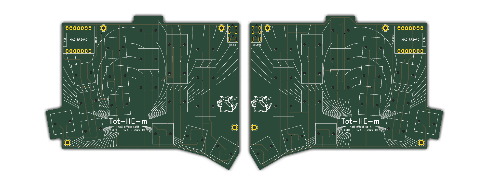
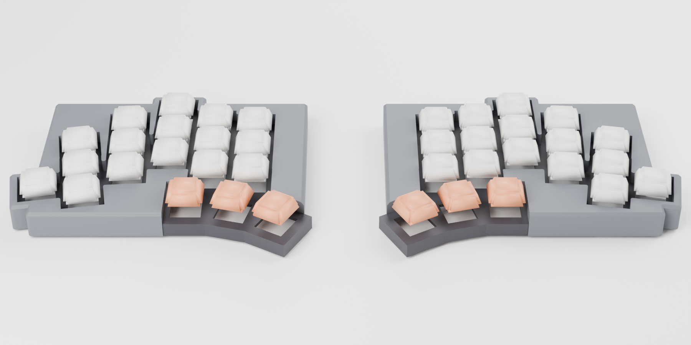
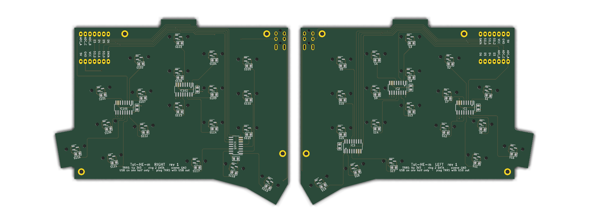

# Tot-HE-m



Tot-HE-m is a hall-effect version of [GEIGEIGEIST's TOTEM](https://github.com/GEIGEIGEIST/TOTEM): the same
38-key split layout, scaled to MX spacing, with a linear hall sensor under every switch instead of a mechanical
contact. The goal is an analog keyboard that is cheap and easy to build at home. Each half is one two-layer PCB
with a handful of SMD parts, a Seeed XIAO RP2040 and a 3D printed case, so everything can be ordered from LCSC,
JLCPCB and the usual keyboard shops, and soldered with an ordinary iron.



## Features

- **Hall-effect sensing on every key**, read through three 74HC4051 multiplexers per half. Tested with MMD C1
  switches; other MX-style magnetic switches (Gateron KS-20, Wooting Lekker and similar) should work as well.
- **Auto calibration.** Each key measures its rest position at power-up and learns where it bottoms out while you
  type; the learnt travel is kept across reboots.
- **Adjustable actuation and release points**, set as key depth in tenths of a millimetre.
- **Rapid trigger**, with separate press and release sensitivity.
- **VIA support**: remap keys and change all of the above live from the browser.
- **Controller layer**: turns W A S D into an analog gamepad stick, so a light press walks and a full press runs.

## Cost

Rough prices for one keyboard, checked October 2026, in euros, before shipping and taxes. Several parts only come
in larger quantities, so ordering for two or more keyboards brings the price per board down a lot.

| Part | Where | Approx. |
| --- | --- | ---: |
| PCBs (5 sets) | JLCPCB | 30 |
| Sensors, muxes, capacitors, TRRS jacks | LCSC | 15 |
| 2x Seeed XIAO RP2040 | Seeed or any electronics shop | 15 |
| 38 magnetic switches | keyboard shop | 20 |
| 38 MX keycaps | keyboard shop | 20 |
| TRRS cable, USB-C cable | any | 10 |
| 8x M2 x 10 screws, rubber bumpers | hardware shop | 5 |
| About 150 g of filament | | 3 |
| **Total** | | **≈ 120** |

## Ordering

**PCB (JLCPCB).** Upload [`production/Tot-HE-m_gerbers.zip`](production/Tot-HE-m_gerbers.zip) on jlcpcb.com. The
file holds both halves side by side, so an order of 5 gives 5 left and 5 right boards. Settings: 2 layers, 1.6 mm,
1 oz copper, any colour; the defaults cover the rest. JLCPCB counts the two outlines as two designs and adds a small
fee for the second, which shows up in the quote. Pick "Remove order number", or it gets printed on the silkscreen.

**Parts (LCSC).** On lcsc.com, open the BOM tool, upload [`production/lcsc_bom.csv`](production/lcsc_bom.csv) and
match the "LCSC Part Number" column. That puts every SMD part and both jacks in the cart in one go, with a few
spares for the small parts:

| Part | LCSC | Per half |
| --- | --- | ---: |
| TI DRV5055A3QDBZR linear hall sensor, SOT-23 | C266128 | 19 |
| 74HC4051D analog mux, SOIC-16 | C9386 | 3 |
| 100 nF capacitor, 0805 | C1711 | 22 |
| PJ-320A TRRS jack | C2884926 | 1 |

**Everything else:** two Seeed XIAO RP2040s, 38 magnetic switches, 38 MX keycaps, a 4-pole TRRS cable, a USB-C
cable, eight M2 x 10 screws and at least eight rubber bumpers taller than 2.5 mm.

The cable has to be **TRRS** (three insulating rings on the plug). A 3-pole TRS cable bridges two contacts in the
jack and shorts the 3.3 V supply, and the keyboard stays dark.

## Building



1. Solder the bottom side first: one hall sensor under every switch position, the three muxes and the capacitors.
   The sensors are wired pin 1 VCC, 2 OUT, 3 GND, the DRV5055's own SOT-23 order.
2. Solder the XIAO flat on its castellated pads, without headers, and the TRRS jack on top. Check every XIAO pad,
   GND and D8 to D10 in particular: a dry joint there makes all keys read wrong.
3. Flash the firmware (below) and check that every key types before closing the case.
4. Clip the switches into the printed plate, put the plate on the PCB, drop the shell over it and fasten each
   corner with an M2 x 10 screw from below, then stick the bumpers on.

Only plug or unplug the TRRS cable with USB disconnected.

## Firmware and VIA

The firmware is QMK. Hold the XIAO's BOOT button while plugging a half in; it shows up as a drive called RPI-RP2.
Copy [`firmware/uf2/tot_he_m_via_left.uf2`](firmware/uf2) onto the left half and `tot_he_m_via_right.uf2` onto the
right. Each image stores its side on first boot. Afterwards, hold Esc and press T to get back into the bootloader.

To configure it in VIA:

1. Open [usevia.app](https://usevia.app) in a Chromium-based browser.
2. Under Settings, turn on **Show Design tab**.
3. In the **Design** tab, load [`firmware/via/tot-he-m.json`](firmware/via/tot-he-m.json). VIA forgets it when the
   browser closes, so load it again next time.
4. In **Configure**, click Authorize device and pick Tot-HE-m.

The keymap editor then works as on any VIA keyboard, and the **Hall effect** menu has the analog settings:

| Setting | Range | Default |
| --- | --- | --- |
| Actuation point | 1.0 to 3.8 mm | 2.0 mm |
| Release point | 0.8 mm up to 0.2 mm shallower than actuation | 1.6 mm |
| Rapid trigger | on / off | off |
| Rapid trigger press and release sensitivity | 0.2 to 2.0 mm | 0.3 mm |
| Stick dead zone (controller layer) | 0 to 2.0 mm | 0 |
| Stick full deflection (controller layer) | 0.5 to 4.0 mm | 3.8 mm |

Settings are stored on the half that is plugged in, which sends them to the other half. On Linux, the browser needs
access to the keyboard's hidraw device; a udev rule for vendor `746d`, product `7e57` with `TAG+="uaccess"` does it.

The default keymap follows a Ferris Sweep layout: QWERTY with Ctrl and Alt on the outer bottom keys and, on the
thumbs, Shift, Space and Esc on the left, Enter, Backspace and GUI on the right. Holding Backspace gives numbers and
symbols, Enter navigation and F-keys, Esc system keys. Hold Esc and press G for the controller layer.

To build the firmware yourself, copy `firmware/qmk/tot_he_m` into `keyboards/` of a QMK checkout and run, for each
half:

```bash
qmk compile -kb tot_he_m -km via -e EXTRAFLAGS=-DINIT_EE_HANDS_LEFT -e TARGET=tot_he_m_via_left
qmk compile -kb tot_he_m -km via -e EXTRAFLAGS=-DINIT_EE_HANDS_RIGHT -e TARGET=tot_he_m_via_right
```

## Case

Each half is a shell and a switch plate, both printed without supports: the shell deck-down, the plate top-down.
The stack is the 1.6 mm PCB, the plate 5 mm above it and the deck 6 mm above the plate, 12.6 mm in total. Each
M2 x 10 screw goes up from under the PCB, through the plate's standoff, and cuts its own thread in a pilot hole in
the deck. The screw heads sit under the PCB, so the bumpers need to be taller than 2.5 mm. For a case that gets
opened often, set `insert = true` in `case/totem_he_case.scad` to use M2 heat-set inserts instead.

The foam mold casts an optional silicone foam layer between the PCB and the plate, which dampens the sound; the
instructions are at the top of `case/foam_mold.scad`.

The STLs are in `case/stl`, made from the OpenSCAD sources (OpenSCAD 2025 or newer):

```bash
openscad --enable=roof -D 'part="shell"' -D 'side="left"' -o case/stl/totemhe_shell_left.stl case/totem_he_case.scad
```

## Repository

| Folder | Contents |
| --- | --- |
| `pcb/` | KiCad project with both halves, and the Ergogen config and footprints the board layout was generated from |
| `production/` | Gerbers for JLCPCB and the LCSC BOM |
| `case/` | OpenSCAD sources and STLs for the shell, plate and foam mold |
| `firmware/` | QMK source, prebuilt images and the VIA definition |

## Credits

Layout and outline from [TOTEM](https://github.com/GEIGEIGEIST/TOTEM) by GEIGEIGEIST (CC BY-NC-SA 4.0), which this
design follows under the same license. The sensor scan is modelled on Boardloaf-HE, the per-key calibration on
Hector. Some footprints are adapted from ceoloide's Ergogen footprints (see `pcb/footprints/LICENSE-ceoloide`).
